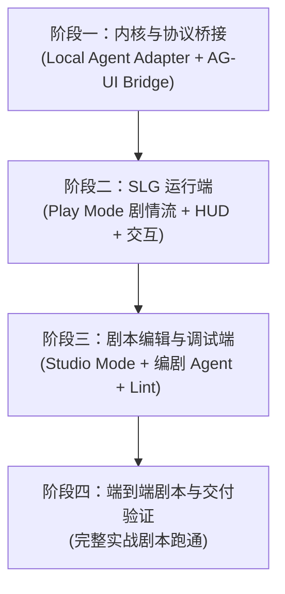

# AG-SLG-FrameWork 开发实施计划 (Development Plan)

## 1. 技术栈与工程选型

- **桥接后端 (Backend)**：Python 3.10+ / FastAPI / `ag-ui-protocol` / `uvicorn` / `pyyaml` / `pydantic`
- **本地 Agent 引擎 (Driver)**：Google Antigravity CLI (`agy`) 默认，兼顾 Codex CLI (`codex`)
- **Web 前端 (Frontend)**：Vite + React 18 + TypeScript + `@ag-ui/client` + Tailwind CSS + Lucide Icons
- **剧本资产库 (Workspaces)**：标准 YAML / JSON 文件体系

---

## 2. 阶段性里程碑与实施清单

---

### 阶段一：本地 Agent CLI 适配器与 AG-UI 协议桥接 (Core Bridge)
**目标**：打通 `前端 HTTP/SSE <--> FastAPI <--> agy / codex 子进程` 的双向通信管道，完成事件协议转译。

- [x] **1.1 项目结构搭建与依赖锁定**
  - 初始化项目目录（`server/`, `web/`, `scripts/`, `docs/`）。
  - 创建后端 `pyproject.toml`，配置 FastAPI 与 `ag-ui-protocol` 依赖。
  - 创建前端 Vite React TypeScript 骨架，安装 `@ag-ui/client` 与 Tailwind。
- [x] **1.2 本地 Agent CLI 驱动器 (`server/agent_driver.py`)**
  - 实现 `BaseAgentDriver` 抽象基类。
  - 实现 `AgyDriver`：封装 `agy -p "..." --output-format stream-json --continue --conversation <id>` 异步流读取。
  - 实现 `CodexDriver`：封装 `codex exec --json ...` 模式作为备用切换。
  - 输出格式解析器：将 CLI 输出的 stdout chunk 转化为规范的 Typed Agent Events。
- [x] **1.3 AG-UI 事件流桥接服务 (`server/app.py` & `server/agui_bridge.py`)**
  - 实现 `POST /api/play/run`：接收 AG-UI `RunAgentInput`，触发游戏 DM 进程，以 SSE 流式吐出 `RunStarted`, `TextMessage*`, `StateDelta`, `RunFinished`。
  - 实现 `POST /api/studio/run`：接收编剧 Agent 交互请求，执行剧本查询、文件修改建议流。
- [x] **1.4 剧本数据模型与加载器 (`server/scenario_manager.py`)**
  - 编写 Pydantic 数据规范（`ScenarioSpec`, `WorldState`, `SceneNode`, `ActionOption`）。
  - 支持从 `scripts/{scenario_id}/` 读写 YAML。
- **阶段一验证标准**：通过简易 curl 或测试脚本触发 `/api/play/run`，能拉起本地 `agy` 产生流式剧本文本，并返回结构化状态事件。已通过 6 项单元/集成测试与真实 `agy` CLI 端到端联调验证通过。

---

### 阶段二：SLG 沉浸运行端 (Play Mode)
**目标**：构建类 SillyTavern 视觉小说体验的 Web 交互界面，实现剧情流式渲染、HUD 数值联动、选项与自由动作。

- [ ] **2.1 游戏主视窗与剧情流 (`web/src/components/play/StoryStream.tsx`)**
  - 接入 `@ag-ui/client` 的 `HttpAgent`，订阅 `onTextMessageContentEvent` 实现打字机逐字渲染。
  - 角色对话框：区分 NPC 台词、系统旁白提示与玩家内心独白。
  - 背景与立绘图层（支持占位与本地素材映射）。
- [ ] **2.2 状态栏与实时 HUD (`web/src/components/play/GameHUD.tsx`)**
  - 订阅 `onStateDeltaEvent`，实时响应玩家生命 HP、精神/理智 SAN、金币、当前场景名变化。
  - 简易道具栏（Inventory 弹窗与悬浮提示）。
- [ ] **2.3 动态动作与决策面板 (`web/src/components/play/ActionPanel.tsx`)**
  - 快速行动按钮组（场景配置内的既定动作）。
  - 自由文本动作输入栏（允许玩家输入任何非预设行为）。
  - 检定与骰子交互反馈（展示 D20 检定或属性比对结果卡片）。
- **阶段二验证标准**：在浏览器打开 Play 界面，可流畅推进至少 3 轮剧情分支，状态栏数值随 Agent 剧情判定实时增减。

---

### 阶段三：剧本编辑与本地 Agent 调试工作台 (Studio Mode)
**目标**：提供开箱即用的可视化剧本管理器，并集成 Studio Co-pilot 编剧 Agent 拥有真实写盘与自动调试能力。

- [ ] **3.1 剧本可视化管理树 (`web/src/components/studio/ScenarioTree.tsx`)**
  - 树形展示当前剧本的世界设定、角色列表、场景分支流向。
  - 单场景详情查看与表单编辑（YAML 源码模式与结构化表单模式双向切换）。
- [ ] **3.2 编剧 Agent 协创侧边栏 (`web/src/components/studio/AuthoringChat.tsx`)**
  - 创作者输入自然语言指令（例如：“帮我补齐地牢场景，需要敏捷 14 才能潜行通过”）。
  - 本地 Agent 直接调动 `write_file` / `edit_file` 原生能力在磁盘创建/修改 YAML 场景文件。
  - 编辑器实时捕获文件系统变化并热重载更新场景树。
- [ ] **3.3 剧本 Lint 与逻辑体检器 (`server/script_linter.py`)**
  - 检查悬空跳转（引用了未定义的 `target_scene`）。
  - 检查未分配初始值的变量或不存在的角色 ID。
- [ ] **3.4 自动化 Agent 模拟试玩 (`web/src/components/studio/PlaytestRunner.tsx`)**
  - 一键启动模拟测试：后台拉起一个虚拟玩家 Agent，自主推进 5 步剧情并输出调试日志与卡点预警。
- **阶段三验证标准**：通过 Studio 对话窗让 Agent 现场扩写一个新场景，该场景自动写入本地 YAML 文件，并在 Play 模式中立即可以游玩。

---

### 阶段四：完整实战剧本与端到端交付 (Delivery & Verification)
**目标**：交付首个可玩开箱范例剧本，完成代码收敛与启动脚本固化。

- [ ] **4.1 编写标杆示例剧本《黑鸦公馆的雨夜》 (`scripts/black_crow_manor/`)**
  - 包含 4~5 个互联场景（大门玄关 -> 门厅走廊 -> 阴暗会客室 -> 锁闭的密室）。
  - 包含 2 个关键 NPC（阴郁的管家、惊恐的客卿）。
  - 包含多属性判定（智力观察、敏捷潜行、力量撬锁）。
- [ ] **4.2 极简一键启动入口 (`start.sh`)**
  - 单条命令自动检测依赖、启动 FastAPI 后端与前端 Vite 服务。
- [ ] **4.3 整体功能回归测试与文档固化**
  - 编写用户快速上手指南（`README.md` 与配置说明）。
- **阶段四验证标准**：执行 `./start.sh` 后打开浏览器，完整跑通游戏试玩、剧本扩写、修改热重载全流程。

---

## 3. 极简实施准则 (Ponytail 规约)

1. **绝对遵循最少代码原则**：
   - 充分复用已有的 CLI 工具（`agy` / `codex`）和官方 SDK（`ag-ui-protocol`, `@ag-ui/client`），严禁徒手造 LLM 调度轮子。
2. **纯粹的文件系统驱动**：
   - 数据存储全部使用 `scripts/{id}/*.yaml` 文件，不引入外部数据库与 ORM。
3. **健壮的容错机制**：
   - Agent 输出文本与状态如果混淆，由正则与 Pydantic 兜底分流，绝不在前端抛未捕获异常。
